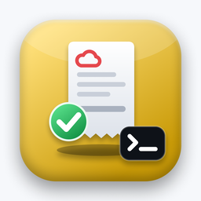

<p align="center"></p>

# oci-free-audit

[](https://github.com/deeplabua/oci-free-audit/actions/workflows/ci.yml)
[](https://crates.io/crates/oci-free-audit)
[](LICENSE)
[](https://github.com/deeplabua/oci-free-audit/stargazers)

**Will Oracle charge me?** A read-only check of your Oracle Cloud (OCI) tenancy against the
Always Free limits — and against what you were actually billed.

One binary, no OCI CLI, no Python. It reads your account, compares every resource with the
Always Free allowance, looks at the real cost in Oracle's Usage API, and prints ✓ / ⚠ / ✗.
**It never changes anything in the account.**

Part of [DeepLab](https://deeplab.tools) — small, sharp tools that run locally. Siblings:
[oci-arm-catcher](https://github.com/deeplabua/oci-arm-catcher) catches a free ARM instance,
[oci-free-keeper](https://github.com/deeplabua/oci-free-keeper) keeps it — and this one makes sure it
stays free. Built on [oci-request-signer](https://github.com/deeplabua/oci-request-signer).


<sub>Recorded against a local mock of the OCI API (`assets/demo/`); the tenancy and its resources are made up.</sub>

## Why

- The usual advice for getting ARM capacity is "upgrade to Pay-As-You-Go". Then a card is on
  file, and a forgotten resource turns into a bill.
- Limits change quietly: on 15 June 2026 Oracle halved the Always Free A1 allowance from
  4 OCPU / 24 GB to 2 OCPU / 12 GB. Some PAYG accounts still pay nothing for 4/24, some may not.
- The console spreads the answer over Limits, Cost Analysis and the create forms. There is no
  single "is everything free?" page.

So the audit trusts money first: if the Usage API shows a non-zero cost, that is a ✗, whatever
the inventory says. Between 2/12 and 4/24 of A1 it lets your own bill decide.

## Install

One self-contained binary for macOS, Linux and Windows. It talks to the OCI API directly —
**no OCI CLI and no Python needed**. Pick one:

**macOS / Linux — Homebrew**

```bash
brew install deeplabua/tap/oci-free-audit
```

**macOS / Linux — installer script**

```bash
curl --proto '=https' --tlsv1.2 -LsSf https://github.com/deeplabua/oci-free-audit/releases/latest/download/oci-free-audit-installer.sh | sh
```

**Windows — PowerShell**

```powershell
powershell -c "irm https://github.com/deeplabua/oci-free-audit/releases/latest/download/oci-free-audit-installer.ps1 | iex"
```

**Any platform — from source** (needs [Rust](https://rustup.rs))

```bash
cargo install oci-free-audit
```

Or download an archive for your platform from
[Releases](https://github.com/deeplabua/oci-free-audit/releases).

It uses the API key in `~/.oci/config` — the same one the OCI CLI and
[oci-arm-catcher](https://github.com/deeplabua/oci-arm-catcher) use.

**Updating.** Run the same install command again, or
`brew upgrade deeplabua/tap/oci-free-audit`. You don't have to watch for releases: at most once a
day the binary asks GitHub for the latest version and, if there is a newer one, prints a short
notice with the command to run (on stderr, so `--json` stays clean). It's off in CI and when stderr isn't a terminal; set
`OCI_FREE_AUDIT_NO_UPDATE_CHECK=1` to turn it off entirely.

## Use

The report:

```sh
oci-free-audit
```

As JSON, for scripts and cron:

```sh
oci-free-audit --json
```

A longer period (the default starts on the 1st of last month):

```sh
oci-free-audit --since 2026-09-01
```

Treat 4 OCPU / 24 GB of A1 as free instead of asking the bill:

```sh
oci-free-audit --a1-limit 4/24
```

Don't mask the tenancy name and OCID:

```sh
oci-free-audit --show-ids
```

Another profile in `~/.oci/config`:

```sh
oci-free-audit --profile OTHER
```

Exit codes: `0` all free, `1` warnings, `2` a charge or a limit exceeded, `3` could not run
(arguments, config, key, network). Put it in cron and alert on non-zero.

The tenancy name and OCID are masked by default, so the report is safe to paste into an issue
or a forum post.

## What it checks

Limits as of 10 November 2026, from
[Always Free Resources](https://docs.oracle.com/iaas/Content/FreeTier/resourceref.htm):

| Area | Rule |
|---|---|
| Cost | any non-zero cost in the Usage API, per month, by service → ✗ |
| Outbound data | ≤ 10 TB per month (⚠ above 80 %) |
| Compute shapes | only `VM.Standard.A1.Flex` and `VM.Standard.E2.1.Micro` are free; anything else running → ✗ |
| A1 | ≤ 2 OCPU / 12 GB ✓; up to 4 / 24 ✓ only if the bill for A1 is zero; above → ✗ |
| E2.1.Micro | ≤ 2 instances |
| Regions | compute and block volumes outside the home region → ✗ (never free there) |
| Block storage | boot + block volumes ≤ 200 GB in the home region (⚠ from 90 %) |
| Volume backups | boot + block ≤ 5 (⚠ at 5: no room left) |
| Object Storage | ≤ 20 GB on an Always Free account; ≤ 10 GB each of Standard and Archive on PAYG |
| Autonomous Database | ≤ 2 with `isFreeTier`; any other running → ✗, stopped → ⚠ (storage billed) |
| MySQL HeatWave | ≤ 1 `MySQL.Free`; any other shape running → ✗ |
| Load balancer | ≤ 1 flexible at 10 Mbit/s; any other shape → ✗ |
| Network load balancer | ≤ 1 (⚠ above) |
| VCN | ≤ 2 on an Always Free account (⚠ above); no cap on PAYG |
| Vault | virtual vaults are free; a virtual private vault → ✗ |
| Budget | a budget with an alert rule exists — otherwise ⚠ and how to create one |

Every subscribed region and every compartment is checked. Anything the API refuses to show is a
⚠ "could not check", never a silent ✓.

## Permissions

Read-only. A user or group with this policy is enough (checked on a real tenancy, 10 November
2026):

```
Allow group <your-group> to inspect all-resources in tenancy
Allow group <your-group> to read usage-report in tenancy
```

With only `inspect`, OCI hides resource names; the report then shows the end of the OCID
instead. Add `Allow group <your-group> to read instances in tenancy` to see instance names, and
`Allow group <your-group> to read buckets in tenancy` for Object Storage sizes.

## Not yet

Vault key versions and secrets counts, Email Delivery and Notifications volumes, the 50,000
Object Storage requests a month, the trial period, notifications. See [`CHANGELOG.md`](CHANGELOG.md).

## Support

If `oci-free-audit` caught a charge before it grew, two things help a lot:

- ⭐ **[Star the repo](https://github.com/deeplabua/oci-free-audit)** — it's how other people worried about a surprise Oracle bill find it.
- ☕ **[Buy me a coffee](https://send.monobank.ua/jar/4Hq7auheaa)** — if it saved you some time and you feel like it.

Both are completely optional. The tool is free and always will be.

## License

[MIT](LICENSE)
